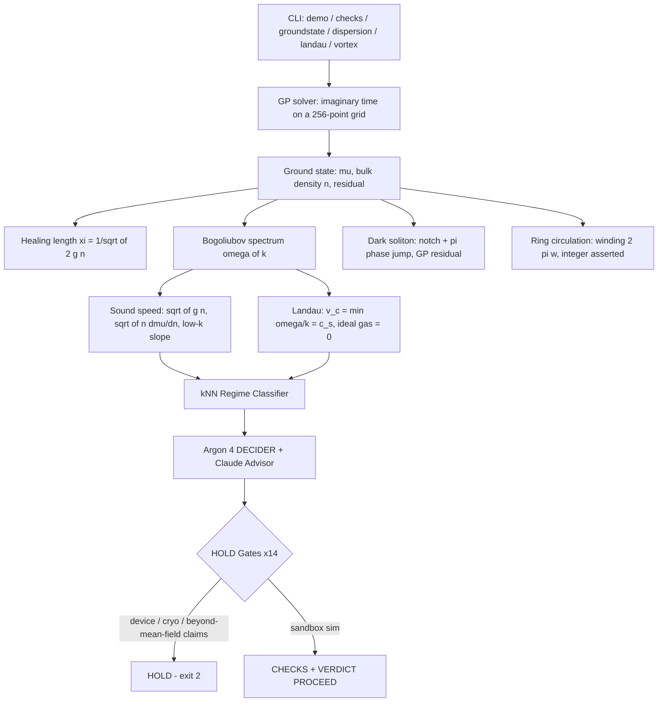
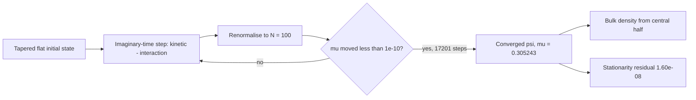
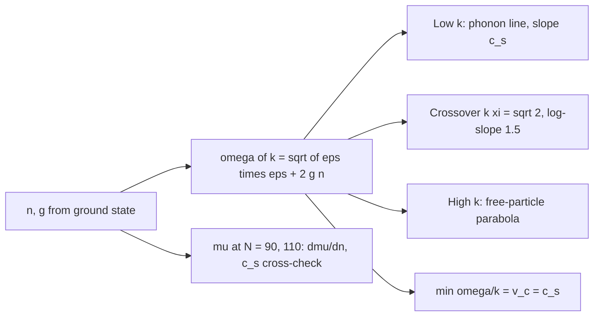
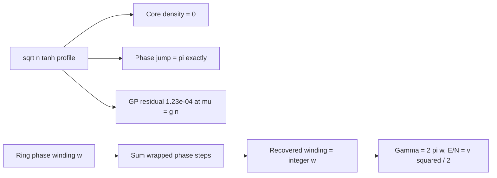
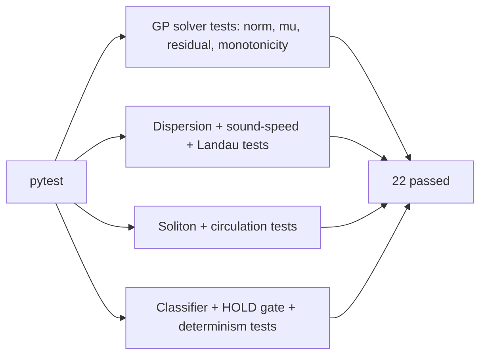
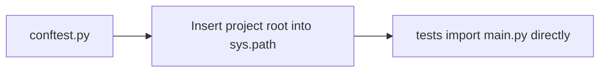
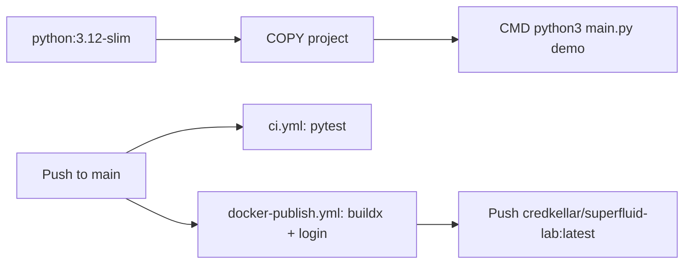

# Superfluid-Lab 🌊⚛️

**Superfluid Lab — Gross-Pitaevskii Ground State, Bogoliubov Spectrum, and the Landau Criterion** — by Darion Kellar

Superfluid-Lab is an **educational superfluid lab** in ONE pure-Python file. It solves the one-dimensional **Gross-Pitaevskii equation** in imaginary time on a finite-difference grid (ℏ = m = 1) for a weakly interacting condensate in a hard-wall box — 256 grid points, 17,201 imaginary-time steps to convergence — and derives everything else from that converged ground state: chemical potential **μ = 0.305243**, bulk density **n = 6.086990**, healing length **ξ = 1.281736**. 🌊

Then it asks the question that defines superfluidity: **how fast can this fluid flow before it can create excitations?** The Bogoliubov spectrum ω(k) = √(ε_k(ε_k + 2gn)) bends from a linear phonon line to a free-particle parabola, the sound speed comes out **c_s = 0.551679** by three independent routes that agree to a third of a percent, and the Landau criterion turns the whole spectrum into one number: **v_c = c_s**, against the ideal gas's **v_c = 0** — no interactions, no phonons, no superfluidity. A dark soliton with an exact π phase jump and quantised ring circulation (whole quanta of 2π, never 1.5) complete the picture. 🔬

Honest scope, stated up front: this is **mean-field physics at T = 0**. There is **no beyond-mean-field (Lee-Huang-Yang) correction** anywhere in this lab, no finite-temperature physics, no quantum depletion — and the Landau velocity is a theorem about a stated spectrum, not a measurement of any material. Every real-world use sits behind a permanent HOLD gate (14 total). 🔒

[](https://github.com/kimanicollier44-cmyk/Superfluid-Lab/actions/workflows/ci.yml)
[](https://github.com/kimanicollier44-cmyk/Superfluid-Lab/actions/workflows/docker-publish.yml)

> ℹ️ These are the **live** workflow badges for this repo. They activate as soon as the `ci.yml` and `docker-publish.yml` files from the paste pack are pasted into `.github/workflows/` — until then they have nothing to report yet.

## 🧰 Tech Stack Badges & Full Architecture Tech Stack

### 💻 Core Programming Languages & Core Systems


- 🐍 Python 3.12, pure standard library (`math`, `cmath`, `hashlib`, `json`, `sys`) — zero dependencies, zero network, deterministic (double-run byte-identical)
- 🌊 Gross-Pitaevskii core from scratch: explicit imaginary-time propagation on a uniform finite-difference grid (Dirichlet box, Δτ = 0.3Δx², renormalised to N = 100 every step), chemical potential as the Rayleigh quotient of the GP operator, stationarity residual computed — not assumed
- 📈 Bogoliubov spectrum evaluated on a 40-point k grid: phonon asymptote, free-particle asymptote, and the crossover at k*ξ = √2 where the log-slope is exactly 3/2
- 🧠 TinyML kNN regime classifier (from scratch, stdlib, distance-weighted): phonon-linear / crossover / free-particle / landau-unstable from (Mach, kξ), labels from the lab's own Landau policy
- 🪑 Council seats: Gemini Argon 4 DECIDER (names-only, tighten-only) + Muse advisor (never overrides HOLD) + Google Flow plan-only (rendered = False, live = 0)

### ⛓️ Web3 & Infrastructure

- 🚫 **Not applicable — honestly.** No blockchain, no Web3, no tokens: the "infrastructure" in this lab is one offline file holding a condensate wavefunction and its excitation spectrum. Real-device deployment is a permanent HOLD gate, not a feature. No fake badges here.

### ⚙️ Platform Support & Hardware Architecture


- 🖥️ Pure Python — runs anywhere Python 3.12+ runs (Linux, macOS, Windows), plus the `python:3.12-slim` Docker image
- 🔒 No hardware is controlled, ever: real condensates, cryostats, and atomtronic circuits are permanent HOLD gates (see the gate table below)

### ⚡ Low-Level Infrastructure & Performance

- 🚫 **No low-level code — honestly.** No C, no C++, no GPU, no compiled extensions: this is one interpreted Python file on purpose, so every amplitude can be read, checked, and diffed. Performance here means honest algorithms — a converged imaginary-time solver with a measured residual (1.60e-08), memoised ground states so the three sound-speed routes share solves, and a full demo + checks run in about five seconds.

### 🛠️ DevOps & Build Tools


- 🐳 Docker (`python:3.12-slim`), GitHub Actions CI + Docker Publish (delivered in the paste pack)
- 🎯 Target image: `credkellar/superfluid-lab:latest`
- 🧪 Tests: `pytest` (22 tests) + the built-in CHECKS suite (52 checks) in `main.py`

### ☁️ Cloud Providers

- 🚫 **None — honestly.** No cloud provider is used or needed: the lab runs fully offline on your own machine or in a local Docker container. Docker Hub appears only as the registry the publish workflow pushes the image to.

## What this does?

1. 🌊 **The ground state, solved not quoted** — the 1D Gross-Pitaevskii equation is propagated in imaginary time on a 256-point grid in a hard-wall box (g = 0.05, N = 100, ℏ = m = 1) until the chemical potential stops moving: **17,201 steps**, stationarity residual **1.60e-08**, norm conserved to 1e-6. The converged **μ = 0.305243** sits 0.29% above the uniform estimate gn = 0.304350 — and the lab says why: the boundary layers carry kinetic energy the uniform estimate ignores.
2. 📏 **The healing length from the converged density** — the bulk density is averaged over the central half of the box (**n = 6.086990**, flat to 0.39%), and ξ = 1/√(2gn) = **1.281736**: the box fits 15.6 healing lengths, so the bulk is a bulk, not a boundary artifact. The wall-adjacent density is suppressed below 1% of bulk, as a hard wall demands.
3. 📈 **The Bogoliubov spectrum, both asymptotes graded** — ω(k) = √(ε_k(ε_k + 2gn)) on a 40-point grid: at k = 0.05, ω/(c_s k) = **1.001026** (the phonon line); at k = 20, ω/(ε_k + gn) = **0.999999** (the free-particle parabola). The spectrum is asserted monotone, and every grid point is labelled phonon / crossover / free-particle by kξ.
4. 🎯 **The crossover, located and characterised** — where ε_k = 2gn, at **k\* = 1.103358** with **k\*ξ = √2 exactly**, the local log-slope d ln ω / d ln k is **1.5000** — precisely midway between the phonon slope (1) and the free-particle slope (2). The bend in the spectrum is a computed point with a computed slope, not a sketch.
5. 🔊 **The sound speed, three independent ways** — √(gn) = **0.551679** from the density; √(n dμ/dn) = **0.549859** from three separate GP solves at N = 90/100/110 (dμ/dn = 0.049671, within 0.66% of g itself); and the low-k dispersion slope = **0.553289**. Worst disagreement: **0.33%**. Compressibility, equation of state, and phonon slope are three different computations — they are not allowed to disagree, and they don't.
6. 🚀 **The Landau criterion** — ω(k)/k = √(k²/4 + gn) rises monotonically from c_s (asserted on a 600-point grid), so **v_c = c_s**: on the grid, v_c = 0.551769 at the smallest k, a factor **1.000164** above c_s, with the k → 0 limit exact. Below v_c a flow cannot pay for an excitation; above it, it can.
7. 🕳️ **The ideal-gas contrast** — switch the interactions off and ω/k = k/2: the on-grid minimum is 0.010000 at k = 0.02 and the limit is **exactly 0**. The Bogoliubov v_c is 55× the ideal gas's on-grid value and infinitely above its limit. That contrast *is* the lesson: superfluidity is bought with interactions, through the phonon line they create.
8. 🌑 **The dark soliton, verified as a solution** — ψ(x) = √n tanh(x/(√2ξ)): core density exactly **0**, phase jump across the core exactly **π** (1.000000π), density recovered to **0.999183** of n by |x| = 6ξ — and the profile is substituted back into the stationary GP equation, returning a relative residual of **1.23e-04** at μ = gn. It is not drawn; it is checked.
9. 🌀 **Quantised circulation on a ring** — phase windings w = 0, 1, 2, 3 are imposed on a 256-point ring and the wrapped phase differences are summed back: the recovered windings are exactly the integers imposed, Γ = 2πw, v = 2πw/L, and the discrete gradient energy matches v²/2 per particle. There is no winding-1.5 state, and the lab proves it by arithmetic.
10. 🏷️ **Regime classifier + seats + checks** — a from-scratch distance-weighted kNN labels scenarios phonon-linear / crossover / free-particle / landau-unstable from the lab's own policy (it agrees with the policy on all 81 grid points), with Argon 4 DECIDER (sha256 trace), Muse advisor, Google Flow plan-only, and a built-in CHECKS suite (52 checks).

## 🗺️ How it works — diagram per script

### `main.py` — the whole lab



### Ground-state subsystem — imaginary-time GP



### Spectrum subsystem — Bogoliubov, sound, Landau



### Vortex subsystem — soliton + ring



### `tests/test_main.py` — verification



### `conftest.py` — test path setup



### `Dockerfile` + CI flow — container & publish



## Why is this cool?

1. 🌊 The ground state is **solved, then graded**: 17,201 imaginary-time steps land on a state whose own stationarity residual is 1.60e-08 — the solver shows its convergence instead of asking to be believed.
2. 🔊 The sound speed is computed **three genuinely different ways** — density, equation-of-state slope from three separate solves, and the phonon's own slope — and the three agree to 0.33%. That is what a cross-check is supposed to look like.
3. 🎯 The crossover between sound and free particles is pinned to a **number with a slope**: k*ξ = √2, log-slope exactly 1.5, midway between the two asymptotes by construction and verified by finite differences.
4. 🚀 The Landau criterion collapses a whole spectrum into **one velocity**, and the lab shows the mechanism: ω/k is monotone, so the minimum is the phonon slope itself — v_c = c_s is derived on the grid, not asserted from a textbook.
5. 🕳️ The ideal-gas contrast is brutal and honest: turn off g and the critical velocity is **zero**. Superfluidity is not a default; it is purchased by interactions, and the price list is the phonon line.
6. 🌑 The dark soliton is **substituted back into its own equation** — notch, π jump, and a 1.23e-04 residual at μ = gn. A profile that solves GP, demonstrated rather than drawn.
7. 🌀 Circulation quantisation is proved by **summing wrapped phase steps around a ring** and recovering the integer — topology reduced to arithmetic you can audit line by line.
8. 📏 The healing length is extracted from the **converged bulk**, with the box certified wide enough (15.6ξ) and the bulk flat enough (0.39%) for the number to mean something.
9. 🪞 The small dishonesty traps are named: μ exceeds gn by 0.29% and the demo explains the boundary kinetic energy instead of rounding it away; the grid v_c exceeds c_s by 0.016% and the k → 0 limit is stated next to it.
10. 🎯 Deterministic end to end: run it twice, get byte-identical output — a superfluid you can diff.

## What problems this solves?

1. ❌ **Problem:** GP ground states in demos are usually quoted from Thomas-Fermi formulas, never solved. ✅ **Solution:** The equation is propagated in imaginary time to a measured residual of 1.60e-08, and μ is read off the converged state as a Rayleigh quotient.
2. ❌ **Problem:** "Sound speed" gets one formula and no cross-check. ✅ **Solution:** √(gn), √(n dμ/dn) from three independent solves, and the low-k dispersion slope — three computations, worst disagreement 0.33%, all asserted in CHECKS.
3. ❌ **Problem:** The phonon-to-free-particle crossover is hand-waved as "somewhere near k ~ 1/ξ". ✅ **Solution:** The crossover is defined (ε_k = 2gn), located (k* = 1.103358, k*ξ = √2), and characterised (log-slope 1.5000, exactly midway).
4. ❌ **Problem:** Landau's criterion is stated, but its mechanism stays invisible. ✅ **Solution:** ω(k)/k is computed on a 600-point grid and asserted monotone — the reader sees v_c = c_s happen, and sees the ideal gas fail the same test with v_c = 0.
5. ❌ **Problem:** Soliton pictures in teaching material are sketches, not solutions. ✅ **Solution:** The tanh profile is graded against the stationary GP equation itself (residual 1.23e-04), its core density is exactly zero, and its phase jump is exactly π.
6. ❌ **Problem:** Circulation quantisation is usually asserted from authority. ✅ **Solution:** Wrapped phase increments are summed around a discrete ring and the integer winding is *recovered* from the sum — for w = 0, 1, 2, 3 — with Γ = 2πw and E/N = v²/2 checked.
7. ❌ **Problem:** Mean-field results get silently upgraded to real-material claims. ✅ **Solution:** `beyond_meanfield_claim`, `finite_temperature_claim`, `superfluid_device_claim`, and 11 sibling HOLD gates return exit code 2 for every real-world use, permanently — and the first demo section states the T = 0 mean-field scope before any number appears.
8. ❌ **Problem:** Boundary effects quietly contaminate bulk numbers in box simulations. ✅ **Solution:** The bulk density is taken from the central half only, its flatness is measured (0.39%), the wall density suppression is checked (< 1%), and the μ-vs-gn excess is attributed to boundary kinetic energy in print.
9. ❌ **Problem:** Healing length is often computed from the *average* density including the walls. ✅ **Solution:** ξ comes from the converged bulk density of the central region, and the check `healing_length_vs_box` certifies the box spans 15.6ξ so bulk physics dominates.
10. ❌ **Problem:** Superfluid demos imply a product — frictionless transport, atomtronics, cryogenics. ✅ **Solution:** `frictionless_transport_product_claim`, `atomtronics_device_claim`, and `cryogenic_system_claim` are HOLD gates #3–#6, and the README's first section says the Landau velocity is a theorem about a spectrum, not a device spec.

## How to install this?

1. 📋 Clone or download this project folder.
2. 🐍 Make sure Python 3.12+ is installed: `python3 --version`
3. ▶️ Run the full demo + checks (no arguments needed):

```bash
python3 main.py
```

4. 🧪 Run the test suite:

```bash
pip install pytest
python3 -m pytest -q
```

5. 🎛️ Try the other commands:

```bash
python3 main.py checks       # 52 built-in checks
python3 main.py groundstate  # converged GP ground state report (JSON)
python3 main.py dispersion   # Bogoliubov spectrum + crossover (JSON)
python3 main.py landau       # sound speed three ways + Landau v_c (JSON)
python3 main.py vortex       # dark soliton + ring circulation (JSON)
python3 main.py classify     # kNN regime classifier report
python3 main.py brains       # Argon 4 + Muse + Flow seats
python3 main.py holds        # list all 14 HOLD gates
python3 main.py hold-demo    # exits 2 - gated actions stay HOLD
```

6. 🐳 Or run it in Docker:

```bash
docker build -t credkellar/superfluid-lab:latest .
docker run --rm credkellar/superfluid-lab:latest
```

## Requirements

- 🐍 Python 3.12 or newer
- 📦 Dependencies: **none** (standard library only)
- 🌐 Network: **none** — fully offline
- 🧪 For tests only: `pytest`
- 🐳 Optional: Docker

## FULL project structure tree

```text
superfluid-lab/
├── main.py                  # the whole lab: GP imaginary-time solver, Bogoliubov spectrum, sound speed x3, Landau criterion, dark soliton, ring circulation, classifier, seats, HOLD gates
├── conftest.py              # puts the project root on sys.path for tests
├── tests/
│   └── test_main.py         # 22 pytest tests: solver, dispersion, sound, Landau, soliton, circulation, gates, determinism
├── assets/
│   └── cover.png            # README cover image (2736 x 912)
├── Dockerfile               # python:3.12-slim, runs the demo
├── .gitignore               # __pycache__/, .pytest_cache/, *.pyc
└── README.md                # this file
```

> 📦 Delivered separately as paste packs (not in this tree): `.github/workflows/ci.yml` + `docker-publish.yml`, and the Docker Hub pack (100-char description, 350-char About, overview, categories).

## 🔒 HOLD gates — all 14, permanent

| # | Gate | What stays held |
|---|------|-----------------|
| 1 | `superfluid_device_claim` | No claim any real device or material is superfluid from this model |
| 2 | `real_condensate_characterization` | No characterising a real condensate's density, μ, or critical temperature |
| 3 | `cryogenic_system_claim` | No cryogenic or cooling-system performance claim from a T = 0 model |
| 4 | `frictionless_transport_product_claim` | No product claim of frictionless transport or persistent-current devices |
| 5 | `quantum_turbulence_control_claim` | No controlling or certifying real quantum turbulence from a 1D model |
| 6 | `atomtronics_device_claim` | No atomtronic circuit or device claim |
| 7 | `beyond_meanfield_claim` | No beyond-mean-field accuracy claim; no LHY correction exists in this lab |
| 8 | `finite_temperature_claim` | No finite-temperature claim; every number is T = 0 mean-field |
| 9 | `simulation_as_measurement_claim` | Simulated densities and velocities must never be presented as measured data |
| 10 | `medical_flow_claim` | No medical, biological, or microfluidic flow claim |
| 11 | `energy_extraction_claim` | No free-energy or perpetual-flow work claim |
| 12 | `product_benchmark_claim` | No product benchmark or marketing figure from lab numbers |
| 13 | `investment_claim` | No investment claims; a lab model is not a prospectus |
| 14 | `standards_compliance_claim` | No claim of compliance with any metrology or cryogenics standard |

🧑‍⚖️ **Council seats:** Gemini Argon 4 Extended Thinking — DECIDER (names-only, tighten-only, MAP → MODEL → STRESS → DECIDE, sha256 trace, `can_override_hold = False`) · Muse — advisor (`can_override_hold = False`) · Google Flow — plan-only (`rendered = False`, `live = 0`).

✅ **Verification:** pytest **22 passed** (project + clean copy) · built-in CHECKS **52/52** · double-run output **byte-identical** · `hold-demo` exits **2** · `main.py` **801 lines**, pure stdlib, zero network.

## 🧒 5th-grade English section

Imagine a crowd of people who all agree to walk in exactly the same direction, like a school of fish. That is roughly what a superfluid is: a fluid whose atoms move together as one team. 🌊

- **The team needs practice time.** This lab lets a pretend fluid settle down on a computer until it finds its calmest shape — like letting a shaken bottle of water go still — and then measures how "deep" that calm state is. 🧘
- **Sound travels through the team.** Poke the fluid gently and a ripple runs through it. This lab measures the ripple's speed **three different ways** and gets the same answer all three times — that is how you know the measurement is honest. 🔊
- **There is a speed limit for smooth flowing.** If the fluid flows slower than the ripple speed, it cannot make waves, so nothing slows it down — it flows perfectly. Flow faster, and waves appear and steal energy. The lab computes that exact speed limit. 🚀
- **A normal, non-teamwork fluid has speed limit zero.** Without the teamwork (the "interactions"), *any* flow can make waves. Teamwork is the whole secret. 🕳️
- **The fluid can hold a dark stripe** — a thin line where the fluid vanishes completely and its wave flips upside down. The lab checks that stripe really is a true solution, not just a drawing. 🌑
- **Going around in a circle comes in whole turns only.** The fluid can circle a ring once, twice, or three times — never one and a half. The lab counts the turns and gets whole numbers back. 🌀
- This project is a **pretend lab on a computer**. It does not make any real fluid flow forever. It teaches *why* superfluids can — with math you can check. 💻

---

MIT © 2026 Darion Kellar · Superfluid-Lab — educational simulation only 🌊
